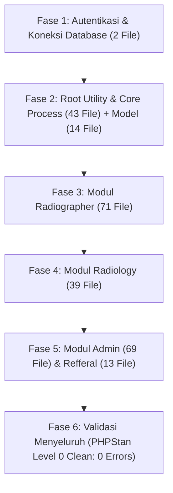

# Rencana Migrasi Proyek Medxa RSOJ Makassar ke PHP 8.3.36

Dokumen ini berisi dokumentasi teknis, analisis arsitektur, peran tools otomasi, serta tahapan eksekusi migrasi menyeluruh dari **PHP 7.3 ke PHP 8.3.36** untuk seluruh **251 file PHP aplikasi** tanpa membebani developer untuk melakukan pengeditan manual satu per satu.

---

## 1. Ringkasan Eksekutif & Karakteristik Proyek

- **Nama Proyek:** `medxa-rsoj-makassar`
- **Tipe Arsitektur:** PHP Prosedural Klasik bercampur HTML/JavaScript (Native, Non-Framework).
- **Total File PHP Aplikasi:** **251 File PHP** (di luar library pihak ketiga yang di-skip).
- **Target Versi PHP:** **PHP 8.3.36** (XAMPP 8.3 di `D:\xampp83\php\php.exe` & Apache di Port `80`).
- **Database Server:** MySQL 5.6 (Port 3306) — *Struktur tabel dan port tidak disentuh*.
- **Batasan Mutlak (Strict Constraints):**
  1. **HTML & CSS tidak boleh disentuh/diubah:** Tampilan antarmuka, tata letak, dan styling harus tetap 100% identik.
  2. **Tanpa Composer di Proyek:** Repositori proyek tetap bersih tanpa `composer.json`, `composer.lock`, maupun folder `vendor/`.
  3. **Library Pihak Ketiga Di-SKIP:** Library eksternal (`ckeditor`, `phpqrcode`, `fpdf`, `vendor/` internal) tidak di-refactor otomatis oleh Rector agar tidak merusak fungsi intinya.

---

## 2. Peran Tools: Rector vs PHPStan vs Eksekusi AI Agent

Memahami perbedaan fungsi dari ketiga komponen ini penting agar ekspektasi hasil refactoring tepat:

| Aspek | Rector (v2.7.0) | PHPStan (v2.3.2) | AI Coding Agent |
| :--- | :--- | :--- | :--- |
| **Fungsi Utama** | *Syntax Modernizer* otomatis | *Static Code Analyzer* / Linter | Eksekutor & Debugger Logika |
| **Kelebihan** | Memodernisasi sintaks class/OOP PHP 8.0-8.3 secara otomatis. | Memindai **seluruh 251 file PHP** secara otomatis dan mendeteksi bug *runtime*, file hilang, dan variabel undefined. | Memperbaiki *breaking changes* prosedural, runtime bug, dan penanganan session di seluruh file proyek. |
| **Batasan** | Tidak mengubah logika prosedural (karena fungsi `mysqli_*` atau `if` prosedural secara sintaksis masih valid di PHP 8.3). | Tidak pernah mengubah atau menulis kode file sendiri. | Bekerja berdasarkan instruksi dan aturan batas proyek. |
| **Status di Proyek** | Dijalankan via [rector.bat](file:///c:/xampp/htdocs/pacs/medxa/medxa-rsoj-makassar/rector.bat) (isolated di `D:\tools\rector`). | Dijalankan via [phpstan.bat](file:///c:/xampp/htdocs/pacs/medxa/medxa-rsoj-makassar/phpstan.bat) (menggunakan `phpstan.phar` mandiri). | Bertanggung jawab menyelesaikan seluruh daftar error PHPStan & kompatibilitas PHP 8.3. |

---

## 3. Analisis Breaking Changes PHP 7.3 $\rightarrow$ PHP 8.3 pada Proyek Ini

Berikut adalah penyebab utama mengapa kode PHP 7.3 mengalami error saat dijalankan di PHP 8.3:

1. **`Warning: Undefined array key "..."`**
   - *Di PHP 7.3:* Hanya menghasilkan *Notice* tersembunyi yang diabaikan.
   - *Di PHP 8.3:* Menghasilkan *Warning* yang memblokir header HTTP `header("Location: ...")`, merusak session redirect, atau mencetak teks ke layar.
   - *Solusi:* Null-coalescing operator (`$var = $_SESSION['level'] ?? ''`).
2. **`TypeError: password_verify()`**
   - *Di PHP 7.3:* Menerima parameter `null` dan otomatis dikonversi menjadi string kosong `""`.
   - *Di PHP 8.3:* Melempar *Fatal TypeError* jika hash password di database bernilai `null` atau kosong.
   - *Solusi:* Guard condition `$data && !empty($data['password']) && password_verify(...)`.
3. **`Trying to access array offset on value of type null`**
   - *Di PHP 7.3:* Mengakses `$data['col']` saat query SQL kosong (`$data === null`) mengembalikan `null` secara diam-diam.
   - *Di PHP 8.3:* Langsung melempar *Warning/Error*.
   - *Solusi:* Pengecekan sebelum array access atau `($data['col'] ?? '')`.
4. **Perubahan Default MySQLi Driver (PHP 8.1+)**
   - *Di PHP 7.3:* Query MySQL yang gagal mengembalikan `false`.
   - *Di PHP 8.3:* Mode default berubah menjadi `MYSQLI_REPORT_ERROR | MYSQLI_REPORT_STRICT` yang melempar exception fatal jika query tidak kompatibel dengan MySQL 5.6.
   - *Solusi:* Penambahan `mysqli_report(MYSQLI_REPORT_OFF);` di [koneksi/koneksi.php](file:///c:/xampp/htdocs/pacs/medxa/medxa-rsoj-makassar/koneksi/koneksi.php).
5. **Penanganan Session & Desinkronisasi Cookie**
   - *Masalah:* Pemanggilan ganda redirect (`index.php` $\rightarrow$ `menu.php` $\rightarrow$ `workload.php`) rentan kehilangan session ID pada localhost browser.
   - *Solusi:* Penempatan `session_start();` di baris paling awal (baris 2) dan *direct routing* langsung ke dashboard target tanpa file perantara yang redundan.
6. **Typo Path Include / Require**
   - Beberapa file warisan menyertakan path tanpa ekstensi (misal `include "../bahasa"` alih-alih `"../bahasa.php"`).

---

## 4. Konfigurasi Tools yang Disinkronkan

Kedua file konfigurasi telah disinkronkan untuk fokus hanya pada kode aplikasi Medxa dan melewati (*skip*) library pihak ketiga serta file statis:

### A. Konfigurasi [rector.php](file:///c:/xampp/htdocs/pacs/medxa/medxa-rsoj-makassar/rector.php)
```php
<?php
declare(strict_types=1);
use Rector\Config\RectorConfig;

return RectorConfig::configure()
    ->withPaths([__DIR__])
    ->withSkip([
        // Folder Assets & Non-PHP
        __DIR__ . '/css', __DIR__ . '/js', __DIR__ . '/image', __DIR__ . '/gambar',
        __DIR__ . '/database', __DIR__ . '/fontawesome', __DIR__ . '/fontawesome6',
        __DIR__ . '/icon-menubar', __DIR__ . '/maintenance_image', __DIR__ . '/log', __DIR__ . '/read-more',

        // Library Pihak Ketiga (Wajib Skip agar tidak rusak)
        __DIR__ . '/radiographer/phpqrcode', __DIR__ . '/radiographer/vendor',
        __DIR__ . '/radiology/ckeditor', __DIR__ . '/radiology/fontawesome',
        __DIR__ . '/radiology/pdf', __DIR__ . '/radiology/phpmailer',
        __DIR__ . '/radiology/phpqrcode', __DIR__ . '/radiology/sign_src', __DIR__ . '/contract',

        // File Temp & Tools
        __DIR__ . '/radiographer/files', __DIR__ . '/radiographer/dcm_temp',
        __DIR__ . '/phpstan.phar', __DIR__ . '/rector.php',
    ])
    ->withPhpSets(php83: true);
```

### B. Konfigurasi [phpstan.neon](file:///c:/xampp/htdocs/pacs/medxa/medxa-rsoj-makassar/phpstan.neon)
```neon
parameters:
    level: 0
    paths:
        - .
    excludePaths:
        - .git
        - database (?)
        - log (?)
        - read-more (?)
        - css (?)
        - js (?)
        - image (?)
        - gambar (?)
        - fontawesome (?)
        - fontawesome6 (?)
        - icon-menubar (?)
        - maintenance_image (?)
        - radiographer/files (?)
        - radiographer/dcm_temp (?)
        - radiographer/phpqrcode (?)
        - radiographer/vendor (?)
        - radiology/ckeditor (?)
        - radiology/fontawesome (?)
        - radiology/phpmailer (?)
        - radiology/phpqrcode (?)
        - radiology/pdf (?)
        - radiology/sign_src (?)
        - contract (?)
        - rector.php
        - phpstan.phar
```

---

## 5. Rencana Kerja Eksekusi & Inventaris Lengkap Seluruh File (251 File)

Seluruh 251 file PHP dibagi ke dalam 6 fase eksekusi sistematis. Semua file di bawah ini tercakup dalam pemindaian dan perbaikan bertahap:



---

### Fase 1: Autentikasi & Koneksi Database (2 File)
Fokus: Login session PHP 8.3, null-safety `password_verify`, MySQL 5.6 compatibility, dan routing bersih.
- [x] [koneksi/koneksi.php](file:///c:/xampp/htdocs/pacs/medxa/medxa-rsoj-makassar/koneksi/koneksi.php) — setting `mysqli_report(MYSQLI_REPORT_OFF);`
- [ ] [index.php](file:///c:/xampp/htdocs/pacs/medxa/medxa-rsoj-makassar/index.php) — perbaikan `$data_temp`, assignment condition baris 46, direct redirect session

---

### Fase 2: Root Utility & Core Process Scripts (43 File) + Folder Model (14 File)
Fokus: Filter tanggal, proses cari, viewer DICOM, modal, dan query base model.
- **Root Files (43 File):**
  - `bahasa.php`, `changedoctor.php`, `chart-hex-rgba.php`, `chart-index.php`, `contract-service.php`
  - `date-time-zone.php`, `default-value.php`, `en.php`, `formsearch.php`, `getAll.php`
  - `getTemplate.php`, `hasil-acc.php`, `hasil-all.php`, `hasil-history-expertise.php`, `hasil-series.php`
  - `hasil-template.php`, `home-index.php`, `id.php`, `log.php`, `logout.php`
  - `menu.php`, `modal.php`, `pasien.php`, `proses-export-excel.php`, `proses-send-dicom.php`
  - `prosescari-fill.php`, `prosescari.php`, `random.php`, `readmore.php`, `recyclebin.php`
  - `report-index.php`, `script-chat.php`, `script-footer.php`, `sidebar-index.php`, `template-create.php`
  - `template-index.php`, `template-update.php`, `thead.php`, `viewer-all.php`, `workload-fill-detail-index.php`
  - `workload-fill-index.php`, `workload-index.php`
- **Folder `model/` (14 File):**
  - `query-base-dokter-radiology.php`, `query-base-dokter-refferal.php`, `query-base-mwl-item.php`
  - `query-base-order.php`, `query-base-patient.php`, `query-base-selected-dokter-radiology.php`
  - `query-base-series-req.php`, `query-base-series.php`, `query-base-study.php`, `query-base-take-envelope.php`
  - `query-base-template.php`, `query-base-workload-bhp.php`, `query-base-workload-fill.php`, `query-base-workload.php`

---

### Fase 3: Modul Radiographer (71 File)
Fokus: Worklist, registrasi prosedur, send DICOM, export Excel, komplain, dan maintenance.
- **Daftar File Radiographer (71 File):**
  - `about.php`, `changedoctorworklist.php`, `chart.php`, `dcmdelete.php`, `dcmdir.php`
  - `dcmsend.php`, `dcm_send.php`, `deleteexam.php`, `deleteexamall.php`, `deletemwl.php`
  - `deleteworkload.php`, `delete_template.php`, `department.php`, `downloadexcel.php`, `exam2.php`
  - `footer-itw.php`, `function_radiographer.php`, `getComplaint.php`, `getExam2.php`, `getOrder2.php`
  - `hapus.php`, `hasil-exam-room.php`, `hasil-order2.php`, `hasilexplanation.php`, `hasilproblem.php`
  - `head.php`, `index.php`, `index2.php`, `indexnew.php`, `logout.php`
  - `maintenance.php`, `maintenance2.php`, `menu-bar.php`, `new_complaint.php`, `new_template.php`
  - `order.php`, `order1.php`, `order2.php`, `prosescaricomplaint.php`, `prosescarimaintenance.php`
  - `prosesexportexcelcomplaint.php`, `prosesexportexcelmaintenance.php`, `recyclebinindex.php`, `registration-live.php`, `registration-prosedur.php`
  - `registration.php`, `registration2.php`, `report.php`, `script-footer.php`, `settings.php`
  - `sidebar.php`, `sidebarnew.php`, `storage.php`, `take-envelope.php`, `type.php`
  - `update-prosedur.php`, `update-workload.php`, `update_complaint.php`, `update_contract.php`, `update_template.php`
  - `uploadexcel.php`, `view-send-dicom.php`, `view_complaint.php`, `view_maintenance copy.php`, `view_maintenance.php`
  - `view_pdf_contract.php`, `view_pdf_contractmaint.php`, `view_template.php`, `workload-fill-detail.php`, `workload-fill.php`
  - `workload.php`

---

### Fase 4: Modul Radiology (39 File)
Fokus: Worklist dokter radiologi, viewer DICOM, integrasi QR code, pelaporan expertise, dan pembuatan PDF.
- **Daftar File Radiology (39 File):**
  - `about.php`, `changedoctorworklist.php`, `data-workload.php`, `data.php`, `data1.php`
  - `delete_template.php`, `dicom.php`, `dualbinding.php`, `footer-itw.php`, `function_radiology.php`
  - `hapustemplate.php`, `head.php`, `index.php`, `logout.php`, `maintenance.php`
  - `menu-bar.php`, `new_template.php`, `order2.php`, `otp.php`, `proses_exam2.php`
  - `qrcode.php`, `qrcode2.php`, `recyclebinindex.php`, `report.php`, `script-footer.php`
  - `selecttext.php`, `settings.php`, `sidebar.php`, `telenotif.php`, `teleotp.php`
  - `templateajax.php`, `update_template.php`, `view_pdf_contract.php`, `view_template.php`, `worklist.php`
  - `workload-edit.php`, `workload-fill-detail.php`, `workload-fill.php`, `workload.php`
- **Catatan FPDF (`radiology/pdf`):** Menambahkan atribut `#[\AllowDynamicProperties]` pada class `FPDF` dan `PDF_HTML` agar kompatibel dengan PHP 8.3 tanpa mengubah layout dokumen hasil bacaan.

---

### Fase 5: Modul Admin (69 File) & Refferal (13 File)
Fokus: Master data, manajemen user, hak akses dokter/radiografer, AE Title, dan portal perujuk.
- **Folder `admin/` (69 File):**
  - `about.php`, `administrator-old.php`, `administrator.php`, `delete_ae_send.php`, `delete_ae_worklist.php`
  - `delete_department.php`, `delete_dokter.php`, `delete_dokter_radiology.php`, `delete_login.php`, `delete_modalitas.php`
  - `delete_payment.php`, `delete_radiographer.php`, `delete_study.php`, `delete_template.php`, `function_dokter.php`
  - `head.php`, `index.php`, `logout.php`, `menu-bar.php`, `new_ae_send.php`
  - `new_ae_worklist.php`, `new_department.php`, `new_dokter.php`, `new_dokter_radiology.php`, `new_expertise.php`
  - `new_hostname_publik.php`, `new_kop_surat.php`, `new_login.php`, `new_modalitas.php`, `new_notification_send_pacs_radiologist.php`
  - `new_notification_unread_radiologist.php`, `new_payment.php`, `new_radiographer.php`, `new_selected_dokter_radiology.php`, `new_study.php`
  - `new_template.php`, `pagination.php`, `script-footer.php`, `updateprofile_dokter_radiology.php`, `updatetemplate_dokter_radiology.php`
  - `update_ae_send.php`, `update_ae_worklist.php`, `update_department.php`, `update_dokter.php`, `update_dokter_radiology.php`
  - `update_dokter_radiology_ttd.php`, `update_login.php`, `update_login_password.php`, `update_modalitas.php`, `update_payment.php`
  - `update_radiographer.php`, `update_study.php`, `update_template.php`, `view_ae_send.php`, `view_ae_worklist.php`
  - `view_department.php`, `view_dokter.php`, `view_dokter_radiology.php`, `view_expertise.php`, `view_hostname_publik.php`
  - `view_login.php`, `view_modalitas.php`, `view_notification_radiologist.php`, `view_payment.php`, `view_poli.php`
  - `view_radiographer.php`, `view_selected_dokter_radiology.php`, `view_study.php`, `view_template.php`
- **Folder `refferal/` (13 File):**
  - `about.php`, `footer-itw.php`, `function_refferal.php`, `head.php`, `index.php`
  - `logout.php`, `menu-bar.php`, `script-footer.php`, `settings.php`, `sidebar.php`
  - `workload-fill-detail.php`, `workload-fill.php`, `workload.php`

---

### Fase 6: Validasi Akhir & QA
- [ ] Menjalankan pemeriksaan penuh PHPStan:
  ```cmd
  .\phpstan.bat analyse --no-progress
  ```
  Target hasil: **`[OK] No errors`** di seluruh file proyek.
- [ ] Menjalankan Rector proses otomatis jika ada sintaks umum yang bisa disederhanakan:
  ```cmd
  .\rector.bat process
  ```
- [ ] Pengujian fungsional login browser:
  - Login Radiographer $\rightarrow$ Worklist/Workload $\rightarrow$ Buka Detail Pasien.
  - Login Radiology $\rightarrow$ List Dicom $\rightarrow$ Cetak PDF Hasil.

---

## 6. Perintah Operasional Cepat

| Aksi | Perintah Terminal |
| :--- | :--- |
| **Cek Analisis PHPStan Seluruh Proyek** | `.\phpstan.bat analyse` |
| **Cek Analisis File Tertentu** | `.\phpstan.bat analyse index.php` |
| **Simulasi Refactoring Rector** | `.\rector.bat process --dry-run` |
| **Eksekusi Refactoring Rector** | `.\rector.bat process` |
| **Cek Status PHP 8.3** | `D:\xampp83\php\php.exe -v` |
