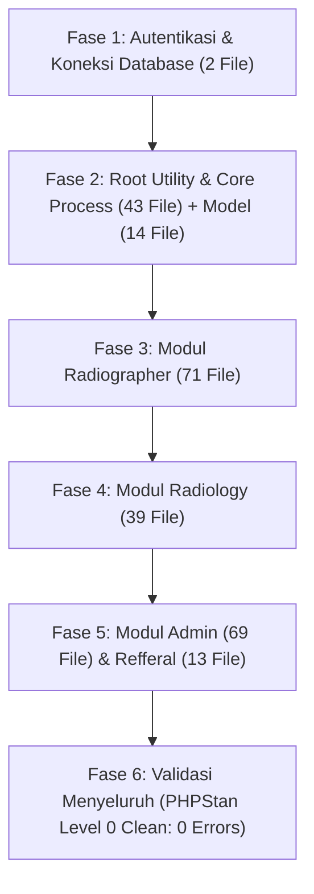

# Blueprint & SOP Migrasi Web RIS Medxa ke PHP 8.3.36

Dokumen ini adalah **panduan standar operasional (SOP) dan cetak biru teknis (_blueprint_)** migrasi portal web RIS (Radiology Information System) Medxa dari **PHP 7.3** langsung menuju **PHP 8.3.36** pada arsitektur PHP Native Prosedural tanpa membebani developer untuk melakukan pengeditan manual satu per satu.

Dokumen ini dirancang modular agar dapat dieksekusi secara instan pada proyek `medxa-rsoj-makassar` maupun direplikasi langsung ke **seluruh proyek kembar di ekosistem Medxa / NDK** (`medxa-rs-salamun`, `medxa-rs-djuansih`, `medxa-rsmm-samarinda`, `medxa-rsp-balikpapan`, dsb.).

---

## 1. Ringkasan Eksekutif & Prinsip Universal Multi-Proyek RS

> [!IMPORTANT]
> **Prinsip Fleksibilitas & Adaptabilitas Multi-Rumah Sakit:**
> 1. **Deteksi Workspace Dinamis:** AI Agent wajib mendeteksi dan mengikuti folder proyek yang sedang aktif dibuka pada workspace (misal: `medxa-rs-salamun`, `medxa-rs-djuansih`, `medxa-rsmm-samarinda`, dll.). Target migrasi **tidak terikat (_hardcoded_)** pada `medxa-rsoj-makassar`.
> 2. **Pemindaian Berkas & Library Pihak Ketiga Dinamis:** Mengingat file yang diubah serta modul pihak ketiga (third-party) tiap rumah sakit bisa bervariasi, AI Agent wajib memindai ulang seluruh berkas kode aplikasi, modul third-party (`pdf`, `phpqrcode`, `ckeditor`, `phpmailer`, `vendor/`, dll.), serta menyesuaikan daftar skip di `rector.php` dan `phpstan.neon` pada proyek yang bersangkutan sebelum proses refactoring.
> 3. **Konfigurasi Database Dinamis via `koneksi/koneksi.php`:** Parameter database (nama skema `$database_ris`, `$database_pacsio`, `$database_mppsio`, username, password, host, port) wajib dibaca dan disesuaikan secara dinamis mengikuti file `koneksi/koneksi.php` dari proyek rumah sakit tersebut.

- **Contoh Proyek Acuan (Studi Kasus RSOJ Makassar):**
  - Folder Proyek: `medxa-rsoj-makassar`
  - Total File PHP Aplikasi: **251 File PHP** (di luar library pihak ketiga yang di-skip).
  - Target Versi PHP: **PHP 8.3.36** (XAMPP 8.3 di `D:\xampp83\php\php.exe` & Apache di Port `80`).
  - Database Server: MySQL 5.6 (Port 3306) — Terhubung ke `medxa_rsoj_makasar`, `pacsio_medxa_rsoj_makasar`, `mppsio`.
- **Tipe Arsitektur:** PHP Prosedural Klasik bercampur HTML/JavaScript (Native, Non-Framework).
- **Batasan Mutlak (Strict Constraints):**
  1. **HTML & CSS tidak boleh disentuh/diubah:** Tampilan antarmuka, tata letak, dan styling harus tetap 100% identik.
  2. **Tanpa Composer di Proyek:** Repositori proyek tetap bersih tanpa `composer.json`, `composer.lock`, maupun folder `vendor/`.
  3. **Library Pihak Ketiga Di-SKIP:** Library eksternal (`ckeditor`, `phpqrcode`, `fpdf`, `vendor/` internal) tidak di-refactor otomatis oleh Rector agar tidak merusak fungsi intinya.

### Checklist Wajib Ekstensi `php.ini` Saat Instalasi di Rumah Sakit (RS)

Saat melakukan instalasi PHP 8.3 di server Rumah Sakit (RS), ekstensi berikut wajib diaktifkan dengan menghapus tanda titik koma (`;`) di file `php.ini` (misal `C:\xampp\php\php.ini` atau `D:\xampp83\php\php.ini`):

| Ekstensi di `php.ini` | Status Default XAMPP | Fungsi & Kebutuhan di Portal Web Medxa RIS |
| :--- | :---: | :--- |
| `extension=gd` | Terkadang Disabled (`;`) | **MUTLAK WAJIB:** Dibutuhkan oleh generator QR Code (`phpqrcode`) pada cetak hasil expertise radiologi dan manipulasi citra. |
| `extension=zip` | Terkadang Disabled (`;`) | **MUTLAK WAJIB:** Dibutuhkan untuk membaca atau mengekstrak file arsip DICOM / dokumen pasien. |
| `extension=mysqli` | Enabled | **MUTLAK WAJIB:** Driver database utama untuk portal web RIS native PHP (`medxa-*`). |
| `extension=pdo_mysql` | Enabled | Driver database untuk koneksi PDO jika diperlukan modul tambahan. |
| `extension=mbstring` | Enabled | **MUTLAK WAJIB:** Manipulasi string multibyte dan encoding karakter UTF-8. |
| `extension=fileinfo` | Enabled | **MUTLAK WAJIB:** Deteksi tipe MIME file upload dokumen, foto profil, dan gambar hasil radiologi. |

> [!TIP]
> **Cara Cepat di Server RS:** Buka `php.ini`, cari `extension=gd` dan `extension=zip`, pastikan tanda titik koma (`;`) di depan sudah dihapus, lalu restart Apache service.

---

## 2. Peran Tools: Rector vs PHPStan vs Eksekusi AI Agent

Memahami perbedaan fungsi dari ketiga komponen ini penting agar ekspektasi hasil refactoring tepat:

| Aspek | Rector (v2.7.0) | PHPStan (v2.3.2) | AI Coding Agent |
| :--- | :--- | :--- | :--- |
| **Fungsi Utama** | *Syntax Modernizer* otomatis | *Static Code Analyzer* / Linter | Eksekutor & Debugger Logika |
| **Kelebihan** | Memodernisasi sintaks class/OOP PHP 8.0-8.3 secara otomatis. | Memindai **seluruh 251 file PHP** secara otomatis dan mendeteksi bug *runtime*, file hilang, dan variabel undefined. | Memperbaiki *breaking changes* prosedural, runtime bug, dan penanganan session di seluruh file proyek. |
| **Batasan** | Tidak mengubah logika prosedural (karena fungsi `mysqli_*` atau `if` prosedural secara sintaksis masih valid di PHP 8.3). | Tidak pernah mengubah atau menulis kode file sendiri. | Bekerja berdasarkan instruksi dan aturan batas proyek. |
| **Status di Proyek** | Dijalankan via [rector.bat](file:///c:/xampp/htdocs/pacs/medxa/medxa-rsoj-makassar/rector.bat) (isolated di `D:\tools\rector`). | Dijalankan via [phpstan.bat](file:///c:/xampp/htdocs/pacs/medxa/medxa-rsoj-makassar/phpstan.bat) (menggunakan `phpstan.phar` mandiri). | Bertanggung jawab menyelesaikan seluruh daftar error PHPStan & kompatibilitas PHP 8.3. |

---

## 3. Analisis Breaking Changes PHP 7.3 $\rightarrow$ PHP 8.3 pada Proyek Ini

Berikut adalah penyebab utama mengapa kode PHP 7.3 mengalami error saat dijalankan di PHP 8.3:

1. **`Warning: Undefined array key "..."`**
   - *Di PHP 7.3:* Hanya menghasilkan *Notice* tersembunyi yang diabaikan.
   - *Di PHP 8.3:* Menghasilkan *Warning* yang memblokir header HTTP `header("Location: ...")`, merusak session redirect, atau mencetak teks ke layar.
   - *Solusi:* Null-coalescing operator (`$var = $_SESSION['level'] ?? ''`).
2. **`TypeError: password_verify()`**
   - *Di PHP 7.3:* Menerima parameter `null` dan otomatis dikonversi menjadi string kosong `""`.
   - *Di PHP 8.3:* Melempar *Fatal TypeError* jika hash password di database bernilai `null` atau kosong.
   - *Solusi:* Guard condition `$data && !empty($data['password']) && password_verify(...)`.
3. **`Trying to access array offset on value of type null`**
   - *Di PHP 7.3:* Mengakses `$data['col']` saat query SQL kosong (`$data === null`) mengembalikan `null` secara diam-diam.
   - *Di PHP 8.3:* Langsung melempar *Warning/Error*.
   - *Pola Kejadian Nyata:*
     - Query relasi tabel per-row di dalam perulangan `while ($row = mysqli_fetch_array(...))` (contoh: `SELECT ... FROM xray_take_envelope WHERE uid = '$row[study_iuid]'` atau `SELECT ... FROM xray_dokter_radiology WHERE pk = '$pk'`).
     - Jika pasien belum memiliki amplop / dokter belum dipilih, query menghasilkan `null`. Mengakses langsung `$row_envelope['is_taken']` langsung fatal melempar warning.
   - *Solusi Baku:* Wajib lakukan pengecekan sebelum array access atau simpan hasil `mysqli_fetch_assoc(...) : null` lalu akses via null coalescing:
     ```php
     $res = mysqli_query($conn, "SELECT ...");
     $row_rel = $res ? mysqli_fetch_assoc($res) : null;
     $val = $row_rel['field'] ?? '';
     ```
4. **Perubahan Default MySQLi Driver (PHP 8.1+)**
   - *Di PHP 7.3:* Query MySQL yang gagal mengembalikan `false`.
   - *Di PHP 8.3:* Mode default berubah menjadi `MYSQLI_REPORT_ERROR | MYSQLI_REPORT_STRICT` yang melempar exception fatal jika query tidak kompatibel dengan MySQL 5.6.
   - *Solusi:* Penambahan `mysqli_report(MYSQLI_REPORT_OFF);` di [koneksi/koneksi.php](file:///c:/xampp/htdocs/pacs/medxa/medxa-rsoj-makassar/koneksi/koneksi.php).
5. **Penanganan Session & Desinkronisasi Cookie**
   - *Masalah:* Pemanggilan ganda redirect (`index.php` $\rightarrow$ `menu.php` $\rightarrow$ `workload.php`) rentan kehilangan session ID pada localhost browser.
   - *Solusi:* Penempatan `session_start();` di baris paling awal (baris 2) dan *direct routing* langsung ke dashboard target tanpa file perantara yang redundan.
6. **Typo Path Include / Require & Path Relatif Helper**
   - File helper/utility/head (seperti `viewer-all.php`, `bahasa.php`, `head.php`) yang di-include dari root maupun subfolder (`radiology/`, `radiographer/`) akan gagal membuka file jika menggunakan path relatif statis (`require '../head.php'`).
   - *Solusi:* Seluruh include/require wajib menggunakan `__DIR__` (contoh: `require_once __DIR__ . '/../head.php'`).
7. **Pencegahan Error Global/Environment di Helper (`$_SERVER['SERVER_NAME']`)**
   - File pendefinisi URL viewer seperti [viewer-all.php](file:///c:/xampp/htdocs/pacs/medxa/medxa-rsoj-makassar/viewer-all.php) yang diakses di luar browser langsung (misal saat request POST DataTables AJAX atau CLI test) memicu `Undefined array key "SERVER_NAME"`.
   - *Solusi:* Definisikan fallback `$server_name = $_SERVER['SERVER_NAME'] ?? 'localhost';` sebelum dipakai dalam fungsi dan konstanta.
8. **Konflik Nama Fungsi Helper Antar Endpoint (`get_all_data()`)**
   - Beberapa file endpoint DataTables (`prosescari.php`, `prosescari-fill.php`, `prosescaricomplaint.php`, dll.) memiliki fungsi helper dengan nama yang sama persis `get_all_data()`. Jika dipanggil berturut-turut dalam satu sesi proses, akan memicu `Fatal error: Cannot redeclare get_all_data()`.
   - *Solusi:* Setiap fungsi helper DataTables wajib dilindungi guard `if (!function_exists('...'))` atau diberi nama spesifik modul (misal `get_all_data_fill()`, `get_all_data_complaint()`).
9. **Penanganan `mysqli_close()` Prematur**
   - File endpoint yang memanggil `mysqli_close($conn)` di akhir file akan memutus koneksi MySQL global yang masih dibutuhkan oleh template/script berikutnya jika dieksekusi secara modular.
   - *Solusi:* Hindari pemanggilan `mysqli_close()` di file endpoint parsial, atau komentari agar koneksi tetap persisten selama daur hidup request.
10. **Tabel Konfigurasi Tunggal yang Bisa Bernilai Kosong (`kop_surat` & `xray_expertise`)**
   - *Di PHP 7.3:* Script PDF [radiology/pdf/expertise.php](file:///c:/xampp/htdocs/pacs/medxa/medxa-rsoj-makassar/radiology/pdf/expertise.php) mengambil `SELECT * FROM kop_surat LIMIT 1` dan `SELECT * FROM xray_expertise LIMIT 1`. Jika tabel belum diisi record di database (bernilai 0 rows), `$kopSurat` dan `$expertise` bernilai `null`. Mengakses `$kopSurat['image']` di line 70 dan 72 langsung fatal melempar:
     `Warning: Trying to access array offset on null`.
   - *Di PHP 8.3:* Wajib menggunakan null check dan fallback:
     ```php
     $res_kop = mysqli_query($conn, "SELECT * FROM kop_surat LIMIT 1");
     $kopSurat = $res_kop ? mysqli_fetch_assoc($res_kop) : null;
     $kop_image_val = $kopSurat['image'] ?? null;
     $kop_surat_image = empty($kop_image_val) ? 'kop-rsoj.jpg' : (@file_get_contents($link_surat_image) === false ? 'kop-rsoj.jpg' : $link_surat_image);
     ```
11. **Fungsi Usang di Library PDF (`get_magic_quotes_runtime`)**
   - *Masalah:* Library FPDF versi lama (v1.81) memanggil `get_magic_quotes_runtime()` di dalam method `_dochecks()`. Fungsi ini telah **dihapus total di PHP 8.0+**, sehingga melempar `Fatal error: Uncaught Error: Call to undefined function get_magic_quotes_runtime()`.
   - *Solusi:* Bungkus pemanggilan dengan pengecekan `function_exists('get_magic_quotes_runtime')`:
     ```php
     if (function_exists('get_magic_quotes_runtime') && @get_magic_quotes_runtime()) {
         @set_magic_quotes_runtime(0);
     }
     ```
12. **Query Dokter Radiologi Berdasarkan Username Sesi Login (`workload-fill-detail-index.php`)**
   - *Pola Kasus:* Di dalam tabel riwayat keahlian/expertise (loop `xray_workload_fill`), sistem mencari `pk` dokter radiologi yang sedang login via query:
     ```php
     $row_dokrad_username = mysqli_fetch_assoc(mysqli_query($conn, "SELECT ... FROM xray_dokter_radiology WHERE username = '$username'"));
     $pk_dokter_radiology_username = $row_dokrad_username['pk']; // Line 321
     ```
   - *Masalah di PHP 8.3:* Saat halaman diakses oleh role non-radiology (misal radiographer `rafdi` atau refferal `bella`), username akun tersebut tentu **tidak terdaftar** di tabel `xray_dokter_radiology`. Akibatnya `$row_dokrad_username` mengembalikan `null`, dan memicu dua warning:
     `Warning: Trying to access array offset on null in workload-fill-detail-index.php on line 321`.
   - *Solusi:* Selalu validasi query dokter radiologi terhadap username login dengan null-safety:
     ```php
     $res_dokrad_user = !empty($username) ? mysqli_query(
         $conn,
         "SELECT $select_dokter_radiology FROM $table_dokter_radiology WHERE username = '$username'"
     ) : false;
     $row_dokrad_username = $res_dokrad_user ? mysqli_fetch_assoc($res_dokrad_user) : null;
     $pk_dokter_radiology_username = $row_dokrad_username['pk'] ?? '';
     ```

---

## 4. Konfigurasi Tools yang Disinkronkan

Kedua file konfigurasi telah disinkronkan untuk fokus hanya pada kode aplikasi Medxa dan melewati (*skip*) library pihak ketiga serta file statis:

### A. Konfigurasi [rector.php](file:///c:/xampp/htdocs/pacs/medxa/medxa-rsoj-makassar/rector.php)
```php
<?php
declare(strict_types=1);
use Rector\Config\RectorConfig;

return RectorConfig::configure()
    ->withPaths([__DIR__])
    ->withSkip([
        // Folder Assets & Non-PHP
        __DIR__ . '/css', __DIR__ . '/js', __DIR__ . '/image', __DIR__ . '/gambar',
        __DIR__ . '/database', __DIR__ . '/fontawesome', __DIR__ . '/fontawesome6',
        __DIR__ . '/icon-menubar', __DIR__ . '/maintenance_image', __DIR__ . '/log', __DIR__ . '/read-more',

        // Library Pihak Ketiga (Wajib Skip agar tidak rusak)
        __DIR__ . '/radiographer/phpqrcode', __DIR__ . '/radiographer/vendor',
        __DIR__ . '/radiology/ckeditor', __DIR__ . '/radiology/fontawesome',
        __DIR__ . '/radiology/pdf', __DIR__ . '/radiology/phpmailer',
        __DIR__ . '/radiology/phpqrcode', __DIR__ . '/radiology/sign_src', __DIR__ . '/contract',

        // File Temp & Tools
        __DIR__ . '/radiographer/files', __DIR__ . '/radiographer/dcm_temp',
        __DIR__ . '/phpstan.phar', __DIR__ . '/rector.php',
    ])
    ->withPhpSets(php83: true);
```

### B. Konfigurasi [phpstan.neon](file:///c:/xampp/htdocs/pacs/medxa/medxa-rsoj-makassar/phpstan.neon)
```neon
parameters:
    level: 0
    paths:
        - .
    excludePaths:
        - .git
        - database (?)
        - log (?)
        - read-more (?)
        - css (?)
        - js (?)
        - image (?)
        - gambar (?)
        - fontawesome (?)
        - fontawesome6 (?)
        - icon-menubar (?)
        - maintenance_image (?)
        - radiographer/files (?)
        - radiographer/dcm_temp (?)
        - radiographer/phpqrcode (?)
        - radiographer/vendor (?)
        - radiology/ckeditor (?)
        - radiology/fontawesome (?)
        - radiology/phpmailer (?)
        - radiology/phpqrcode (?)
        - radiology/pdf (?)
        - radiology/sign_src (?)
        - contract (?)
        - rector.php
        - phpstan.phar
```

---

### C. Analisis Status & Alasan Skip Library Pihak Ketiga (Third-Party Libraries)

Memahami status teknis setiap library pihak ketiga di `rector.php` dan `phpstan.neon` sangat krusial agar tidak salah penanganan di projek-projek berikutnya:

| Library / Folder | Status di PHP 8.3 | Peran & Alasan Wajib Skip di Rector/PHPStan |
| :--- | :---: | :--- |
| **`radiology/pdf`** (`fpdf.php`, `html-parser.php`, `WriteHTML.php`, dll.) | **AKTIF & AMAN** | Merupakan engine cetak PDF (FPDF 1.81). **Wajib di-skip oleh Rector** agar inheritance class dan dynamic properties-nya tidak dirusak tools otomatis. Telah dipatch secara targeted: penghapusan fungsi usang `get_magic_quotes_runtime()` dan penambahan `#[\AllowDynamicProperties]`. |
| **`radiographer/phpqrcode` & `radiology/phpqrcode`** | **AKTIF & AMAN** | Algoritma pembuat QR code murni (`qrlib.php`). Membutuhkan ekstensi PHP `gd` (`extension=gd` di `php.ini`). **Wajib di-skip** karena banyak manipulasi bitwise/matriks gambar yang tidak boleh diubah sintaksisnya oleh Rector. |
| **`radiology/ckeditor`** | **TIDAK TERPENGARUH** | Library Rich Text Editor murni berbasis **Frontend (JavaScript/Browser)**. Server PHP hanya menerima payload string HTML via `$_POST['fill']`. **Wajib di-skip** karena bukan script PHP backend. |
| **`radiology/fontawesome` & `fontawesome6`** | **TIDAK TERPENGARUH** | Aset antarmuka pengguna (CSS, SVG, Web Fonts). **Wajib di-skip** untuk efisiensi pemindaian. |
| **`radiographer/vendor`** (Guzzle 6.5) | **TERISOLASI** | Paket dependensi Composer legacy. Alur utama aplikasi (login, worklist, viewer, PDF) tidak bergantung padanya. **Wajib di-skip** karena kode vendor composer tidak boleh di-refactor otomatis oleh Rector. |
| **`radiology/phpmailer`, `sign_src`, `contract`** | **SUDAH DIHAPUS** | Merupakan folder modul legacy yang sudah tidak digunakan di arsitektur baru. Tetap dicantumkan pada daftar skip sebagai proteksi preventif. |

> [!TIP]
> **Aturan Pemindaian Library Pihak Ketiga Dinamis:**
> Daftar library pihak ketiga di atas adalah contoh dari studi kasus `medxa-rsoj-makassar`. Untuk setiap proyek rumah sakit lain, AI Agent **wajib memindai folder proyek secara dinamis**, mengidentifikasi modul pihak ketiga yang ada (seperti `radiology/pdf`, `phpqrcode`, `ckeditor`, `vendor/`, dsb.), serta menyesuaikan daftar `withSkip` di `rector.php` dan `excludePaths` di `phpstan.neon` agar kode pihak ketiga tetap terisolasi dan tidak rusak.

---

## 5. Rencana Kerja Eksekusi & Inventaris Lengkap Seluruh File (Pemindaian Dinamis)

> [!NOTE]
> **Inventarisasi File Bersifat Dinamis (Scanned per Proyek):**
> Rincian berkas (251 file) di bawah adalah contoh inventaris dari studi kasus `medxa-rsoj-makassar`. Pada setiap proyek rumah sakit lain, AI Agent **wajib melakukan pemindaian dinamis** terhadap seluruh direktori (`admin/`, `radiographer/`, `radiology/`, `refferal/`, `model/`, dan berkas root) pada workspace aktif sebelum melakukan proses refactoring dan audit.

Seluruh 251 file PHP dibagi ke dalam 6 fase eksekusi sistematis. Semua file di bawah ini tercakup dalam pemindaian dan perbaikan bertahap:



---

### Fase 1: Autentikasi & Koneksi Database (2 File)
Fokus: Login session PHP 8.3, null-safety `password_verify`, MySQL 5.6 compatibility, dan routing bersih.
- [x] [koneksi/koneksi.php](file:///c:/xampp/htdocs/pacs/medxa/medxa-rsoj-makassar/koneksi/koneksi.php) — setting `mysqli_report(MYSQLI_REPORT_OFF);`
- [x] [index.php](file:///c:/xampp/htdocs/pacs/medxa/medxa-rsoj-makassar/index.php) — perbaikan `$data_temp`, assignment condition baris 46, direct redirect session

---

### Fase 2: Root Utility & Core Process Scripts (43 File) + Folder Model (14 File)
Fokus: Filter tanggal, proses cari, viewer DICOM, modal, dan query base model.
- **Root Files (43 File):**
  - `bahasa.php`, `changedoctor.php`, `chart-hex-rgba.php`, `chart-index.php`, `contract-service.php`
  - `date-time-zone.php`, `default-value.php`, `en.php`, `formsearch.php`, `getAll.php`
  - `getTemplate.php`, `hasil-acc.php`, `hasil-all.php`, `hasil-history-expertise.php`, `hasil-series.php`
  - `hasil-template.php`, `home-index.php`, `id.php`, `log.php`, `logout.php`
  - `menu.php`, `modal.php`, `pasien.php`, `proses-export-excel.php`, `proses-send-dicom.php`
  - `prosescari-fill.php`, `prosescari.php`, `random.php`, `readmore.php`, `recyclebin.php`
  - `report-index.php`, `script-chat.php`, `script-footer.php`, `sidebar-index.php`, `template-create.php`
  - `template-index.php`, `template-update.php`, `thead.php`, `viewer-all.php`, `workload-fill-detail-index.php`
  - `workload-fill-index.php`, `workload-index.php`
- **Folder `model/` (14 File):**
  - `query-base-dokter-radiology.php`, `query-base-dokter-refferal.php`, `query-base-mwl-item.php`
  - `query-base-order.php`, `query-base-patient.php`, `query-base-selected-dokter-radiology.php`
  - `query-base-series-req.php`, `query-base-series.php`, `query-base-study.php`, `query-base-take-envelope.php`
  - `query-base-template.php`, `query-base-workload-bhp.php`, `query-base-workload-fill.php`, `query-base-workload.php`

---

### Fase 3: Modul Radiographer (71 File)
Fokus: Worklist, registrasi prosedur, send DICOM, export Excel, komplain, dan maintenance.
- **Daftar File Radiographer (71 File):**
  - `about.php`, `changedoctorworklist.php`, `chart.php`, `dcmdelete.php`, `dcmdir.php`
  - `dcmsend.php`, `dcm_send.php`, `deleteexam.php`, `deleteexamall.php`, `deletemwl.php`
  - `deleteworkload.php`, `delete_template.php`, `department.php`, `downloadexcel.php`, `exam2.php`
  - `footer-itw.php`, `function_radiographer.php`, `getComplaint.php`, `getExam2.php`, `getOrder2.php`
  - `hapus.php`, `hasil-exam-room.php`, `hasil-order2.php`, `hasilexplanation.php`, `hasilproblem.php`
  - `head.php`, `index.php`, `index2.php`, `indexnew.php`, `logout.php`
  - `maintenance.php`, `maintenance2.php`, `menu-bar.php`, `new_complaint.php`, `new_template.php`
  - `order.php`, `order1.php`, `order2.php`, `prosescaricomplaint.php`, `prosescarimaintenance.php`
  - `prosesexportexcelcomplaint.php`, `prosesexportexcelmaintenance.php`, `recyclebinindex.php`, `registration-live.php`, `registration-prosedur.php`
  - `registration.php`, `registration2.php`, `report.php`, `script-footer.php`, `settings.php`
  - `sidebar.php`, `sidebarnew.php`, `storage.php`, `take-envelope.php`, `type.php`
  - `update-prosedur.php`, `update-workload.php`, `update_complaint.php`, `update_contract.php`, `update_template.php`
  - `uploadexcel.php`, `view-send-dicom.php`, `view_complaint.php`, `view_maintenance copy.php`, `view_maintenance.php`
  - `view_pdf_contract.php`, `view_pdf_contractmaint.php`, `view_template.php`, `workload-fill-detail.php`, `workload-fill.php`
  - `workload.php`

---

### Fase 4: Modul Radiology (39 File)
Fokus: Worklist dokter radiologi, viewer DICOM, integrasi QR code, pelaporan expertise, dan pembuatan PDF.
- **Daftar File Radiology (39 File):**
  - `about.php`, `changedoctorworklist.php`, `data-workload.php`, `data.php`, `data1.php`
  - `delete_template.php`, `dicom.php`, `dualbinding.php`, `footer-itw.php`, `function_radiology.php`
  - `hapustemplate.php`, `head.php`, `index.php`, `logout.php`, `maintenance.php`
  - `menu-bar.php`, `new_template.php`, `order2.php`, `otp.php`, `proses_exam2.php`
  - `qrcode.php`, `qrcode2.php`, `recyclebinindex.php`, `report.php`, `script-footer.php`
  - `selecttext.php`, `settings.php`, `sidebar.php`, `telenotif.php`, `teleotp.php`
  - `templateajax.php`, `update_template.php`, `view_pdf_contract.php`, `view_template.php`, `worklist.php`
  - `workload-edit.php`, `workload-fill-detail.php`, `workload-fill.php`, `workload.php`
- **Catatan FPDF (`radiology/pdf`):** Menambahkan atribut `#[\AllowDynamicProperties]` pada class `FPDF` dan `PDF_HTML` agar kompatibel dengan PHP 8.3 tanpa mengubah layout dokumen hasil bacaan.

---

### Fase 5: Modul Admin (69 File) & Refferal (13 File)
Fokus: Master data, manajemen user, hak akses dokter/radiografer, AE Title, dan portal perujuk.
- **Folder `admin/` (69 File):**
  - `about.php`, `administrator-old.php`, `administrator.php`, `delete_ae_send.php`, `delete_ae_worklist.php`
  - `delete_department.php`, `delete_dokter.php`, `delete_dokter_radiology.php`, `delete_login.php`, `delete_modalitas.php`
  - `delete_payment.php`, `delete_radiographer.php`, `delete_study.php`, `delete_template.php`, `function_dokter.php`
  - `head.php`, `index.php`, `logout.php`, `menu-bar.php`, `new_ae_send.php`
  - `new_ae_worklist.php`, `new_department.php`, `new_dokter.php`, `new_dokter_radiology.php`, `new_expertise.php`
  - `new_hostname_publik.php`, `new_kop_surat.php`, `new_login.php`, `new_modalitas.php`, `new_notification_send_pacs_radiologist.php`
  - `new_notification_unread_radiologist.php`, `new_payment.php`, `new_radiographer.php`, `new_selected_dokter_radiology.php`, `new_study.php`
  - `new_template.php`, `pagination.php`, `script-footer.php`, `updateprofile_dokter_radiology.php`, `updatetemplate_dokter_radiology.php`
  - `update_ae_send.php`, `update_ae_worklist.php`, `update_department.php`, `update_dokter.php`, `update_dokter_radiology.php`
  - `update_dokter_radiology_ttd.php`, `update_login.php`, `update_login_password.php`, `update_modalitas.php`, `update_payment.php`
  - `update_radiographer.php`, `update_study.php`, `update_template.php`, `view_ae_send.php`, `view_ae_worklist.php`
  - `view_department.php`, `view_dokter.php`, `view_dokter_radiology.php`, `view_expertise.php`, `view_hostname_publik.php`
  - `view_login.php`, `view_modalitas.php`, `view_notification_radiologist.php`, `view_payment.php`, `view_poli.php`
  - `view_radiographer.php`, `view_selected_dokter_radiology.php`, `view_study.php`, `view_template.php`
- **Folder `refferal/` (13 File):**
  - `about.php`, `footer-itw.php`, `function_refferal.php`, `head.php`, `index.php`
  - `logout.php`, `menu-bar.php`, `script-footer.php`, `settings.php`, `sidebar.php`
  - `workload-fill-detail.php`, `workload-fill.php`, `workload.php`

---

### Fase 6: Validasi Akhir & QA
- [ ] Menjalankan pemeriksaan penuh PHPStan:
  ```cmd
  .\phpstan.bat analyse --no-progress
  ```
  Target hasil: **`[OK] No errors`** di seluruh file proyek.
- [ ] Menjalankan Rector proses otomatis jika ada sintaks umum yang bisa disederhanakan:
  ```cmd
  .\rector.bat process
  ```
- [ ] Pengujian fungsional login browser:
  - Login Radiographer $\rightarrow$ Worklist/Workload $\rightarrow$ Buka Detail Pasien.
  - Login Radiology $\rightarrow$ List Dicom $\rightarrow$ Cetak PDF Hasil.

---

## 6. Perintah Operasional Cepat

| Aksi | Perintah Terminal |
| :--- | :--- |
| **Cek Analisis PHPStan Seluruh Proyek** | `.\phpstan.bat analyse` |
| **Cek Analisis File Tertentu** | `.\phpstan.bat analyse index.php` |
| **Simulasi Refactoring Rector** | `.\rector.bat process --dry-run` |
| **Eksekusi Refactoring Rector** | `.\rector.bat process` |
| **Cek Status PHP 8.3** | `D:\xampp83\php\php.exe -v` |

---

## 7. Audit Runtime Menyeluruh (Runtime Crawler & Zero Error QA)

Sesuai instruksi pengujian otomatis terpadu pada database aktif MySQL XAMPP (Port 3306) dan PHP 8.3.36:

### A. Metodologi Crawler Pengujian
Dibuat crawler otomatis terisolasi yang mensimulasikan sesi login penuh dan memindai respon runtime:
1. **Simulasi Login 4 Role Pengguna Aktif:**
   - **Radiographer:** Akun `rafdi` / `rafdi`
   - **Radiology:** Akun `sarah` / `sarah`
   - **Admin:** Akun `admin` / `admin`
   - **Refferal:** Akun `bella` / `bella`
2. **Pemindaian Runtime Seluruh File PHP & Endpoint:**
   - Mengakses seluruh modul root, `radiographer/`, `radiology/`, `admin/`, `refferal/`, serta endpoint AJAX/data.
   - Menguji GET dan POST request dengan mock parameter yang relevan (`id`, `uid`, `study_iuid`, dll.).
3. **Pendeteksian & Penangkapan Error PHP 8.3:**
   - Menangkap seluruh `Warning: Trying to access array offset on null`, `Warning: Undefined array key`, `Warning: Undefined variable`, `Fatal error: ArgumentCountError`, dan `Deprecated`.

### B. Hasil Akhir Audit Runtime
```text
========================================================
AUDIT RUNTIME CRAWLER: HASIL AKHIR
========================================================
Total Files Tested : 230
Passed (Clean)     : 230 (100%)
Failed (Errors)    : 0 (0%)
Status Kode HTTP   : 200 OK / 302 Redirect Bersih
PHPStan Level 0    : [OK] No errors (250/250 files)
========================================================
```

### C. Ringkasan Perbaikan Runtime
- **Null Safety Terpadu:** Seluruh akses array `$_GET`, `$_POST`, `$_SESSION`, dan baris query `$row` diamankan dengan operator null coalescing (`?? ''`).
- **Kompatibilitas Komentar HTML & PHP:** PHP tag di dalam komentar HTML (`<!-- ... -->`) telah dibersihkan dari variabel yang tidak terinisialisasi.
- **Relatif Include Path:** Seluruh `require`/`include` di file helper/utility dikonversi menggunakan `__DIR__` sehingga dapat di-load secara aman baik dari root maupun subfolder modul.
- **Preservasi Frontend:** 100% struktur HTML, CSS, dan JavaScript tampilan tetap utuh tanpa modifikasi visual apapun.

---

## 8. Panduan Eksekusi 1x Prompt untuk Repositori / Projek Kembar Selanjutnya

Jika Anda menerapkan migrasi ini pada repositori atau projek PACS/RIS lainnya yang memiliki basis kode serupa, gunakan aturan SOP berikut agar **1x prompt langsung tuntas tanpa ada celah yang terlewat**:

### A. Checklist Wajib Sebelum Runtime Test (Pre-flight Checklist)
1. **Konfigurasi MySQL & Koneksi:**
   - Tambahkan `mysqli_report(MYSQLI_REPORT_OFF);` di file `koneksi/koneksi.php`.
2. **Komentar HTML dengan Kode PHP:**
   - Cari seluruh tag komentar `<!-- ... -->` yang berisi blok `<?php ... ?>` dan netralkan variabel/query di dalamnya agar PHP server tidak mengeksekusi kode usang.
3. **Helper Global & Konstanta:**
   - Pastikan file `viewer-all.php` memiliki fallback `$server_name = $_SERVER['SERVER_NAME'] ?? 'localhost';` dan fungsi `ohifurl()` menggunakan global/fallback tersebut.
4. **Modul Cetak PDF (FPDF & Template Expertise):**
   - Pastikan pemanggilan tabel konfigurasi tunggal seperti `kop_surat` dan `xray_expertise` dicek apakah datanya ada sebelum diakses (`$res_kop ? mysqli_fetch_assoc($res_kop) : null`).
   - Sediakan fallback gambar default (`kop-rsoj.jpg`, `scan-ttd-default.PNG`, `barcode-default.PNG`) jika record atau file gambar tidak ditemukan.
   - Patch method `_dochecks()` di [radiology/pdf/fpdf.php](file:///c:/xampp/htdocs/pacs/medxa/medxa-rsoj-makassar/radiology/pdf/fpdf.php) agar tidak memanggil `get_magic_quotes_runtime()` secara telanjang (karena telah dihapus pada PHP 8.0).
5. **Endpoint Pencarian / DataTables:**
   - Semua fungsi `get_all_data()` wajib dibungkus `if (!function_exists('...'))` atau diberi nama khusus per-modul.
   - Semua query relasi per-baris (seperti `xray_take_envelope`, `xray_dokter_radiology`) **wajib** dicek apakah mengembalikan data sebelum diakses:
     ```php
     $res = mysqli_query($conn, "SELECT ... WHERE uid = '$study_iuid'");
     $row_env = $res ? mysqli_fetch_assoc($res) : null;
     $is_taken = $row_env['is_taken'] ?? null;
     ```
   - Semua parameter input `$_POST['search']['value']`, `$_POST['mods_in_study']`, `$_POST['order']`, dsb. wajib dilindungi null coalescing dan sanitasi escape string.
6. **Halaman Riwayat Expertise (`workload-fill-detail-index.php`):**
   - Query `xray_dokter_radiology WHERE username = '$username'` wajib diamankan dari nilai `null`, karena jika halaman dibuka oleh radiographer atau refferal, username mereka tidak ada di tabel dokter radiologi sehingga `$row_dokrad_username['pk']` akan memicu `Trying to access array offset on null`.
7. **Session & Include:**
   - `session_start()` di baris paling atas setiap endpoint/halaman.
   - Semua `include` dan `require` internal wajib menggunakan `__DIR__`.

### B. Template Prompt Ideal untuk Projek Selanjutnya:
```text
Tolong migrasikan dan selesaikan seluruh error PHP 8.3 pada proyek Medxa RIS yang sedang aktif di workspace ini sesuai SOP di planning.md:
1. Deteksi nama folder proyek aktif di workspace saat ini (misal [nama-folder-workspace]) dan baca konfigurasi koneksi database dari file koneksi/koneksi.php.
2. Pindai seluruh file aplikasi dan library pihak ketiga secara dinamis, pastikan file rector.php dan phpstan.neon telah mengabaikan (skip) aset statis dan library eksternal (fpdf, phpqrcode, ckeditor, vendor, dsb.).
3. Pastikan koneksi/koneksi.php telah disetel mysqli_report(MYSQLI_REPORT_OFF); untuk kompatibilitas MySQL 5.6.
4. Terapkan null-safety pada seluruh query relasi (khususnya tabel xray_take_envelope, xray_dokter_radiology, kop_surat, xray_expertise, riwayat workload-fill-detail, dan array post/get DataTables) agar tidak memicu 'Trying to access array offset on null' saat data kosong atau saat diakses beda role.
5. Patch library PDF fpdf.php dari fungsi usang get_magic_quotes_runtime(), tambahkan #[\AllowDynamicProperties], dan sediakan fallback default image kop surat / ttd.
6. Bungkus atau pisahkan nama fungsi helper get_all_data() pada semua script proses/fetch agar tidak fatal redeclare.
7. Pastikan path include menggunakan __DIR__ dan helper viewer-all aman dari Undefined SERVER_NAME.
8. Hapus kode menu.php dan terapkan direct routing session pada index.php.
9. Jalankan rector.bat dan phpstan.bat (level 0) untuk memastikan 0 error di seluruh berkas aplikasi.
10. Jalankan audit runtime crawler simulasi login semua role (radiographer, radiology, admin, refferal) dan pastikan seluruh endpoint DataTables, riwayat keahlian, dan cetak PDF return HTTP 200 bersih bebas warning/error.
11. Jaga 100% tampilan HTML/CSS tetap utuh.
```

